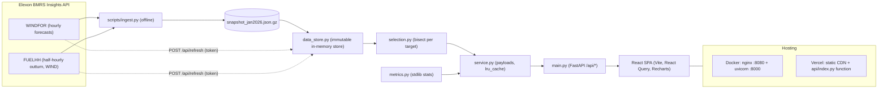

# WindSight — Day‑Ahead Wind Desk

WindSight helps a UK utility's day-ahead power-buying team decide how much of tomorrow's GB wind
generation they can rely on. For each delivery day it shows the wind forecast the desk could actually
have seen at its decision cut-off, how that forecast compared with metered outturn, and a P10/P90
shortfall-risk band that turns January 2026's forecast errors into a concrete number: reliable wind at
90% confidence, and the extra energy to procure on top of the raw forecast. It uses public Elexon BMRS
data only (WINDFOR forecasts and FUELHH wind outturn), with a React frontend and a FastAPI backend.

## Links

- Demo video: <link to unlisted youtube video>
- Live app: https://supreme-potato-murex.vercel.app
- Repo: https://github.com/cryptasim/supreme-potato

## Screenshots

TODO: add screenshots to `docs/screenshots/` (Decision Desk, Forecast Accuracy, Methodology) and embed them here.

## Key results (January 2026, delivery days 2 Jan to 1 Feb)

All figures come from the API on the committed snapshot (744 delivery hours, settlement-point
alignment unless stated). Error = forecast − actual, so a positive value is an over-forecast.

| Metric | 09:00 D-1 cut-off (lead 16.5–39.5 h) | Fixed 4 h lead |
|---|---|---|
| MAE | 2,022.5 MW | 1,719.4 MW |
| RMSE | 2,497.4 MW | 2,199.7 MW |
| Bias (mean error) | +1,745.9 MW | +1,524.4 MW |
| nMAE (MAE ÷ mean actual 11,285.5 MW) | 17.92% | 15.24% |
| P90 absolute error | 4,154.4 MW | 3,641.2 MW |
| Max absolute error | 6,894.0 MW | 7,280.0 MW |
| R² | 0.6475 | 0.7266 |

Findings at the 09:00 cut-off:

- **Systematic over-forecast.** Summed over the month, the selected forecasts total 9,695 GWh against
  8,396 GWh of metered wind, about 15.5% higher. The median of (actual − forecast) is −1,581.5 MW.
- **Shortfall band.** q10 of (actual − forecast) is −4,154.4 MW and q90 is +426.4 MW. The band is
  lopsided: the raw forecast sits near the optimistic end of the outcomes.
- **Reliable wind and extra to procure.** For 15 Jan, the forecast was 278.6 GWh, P10 (reliable wind)
  was 178.9 GWh, so the extra to procure was 99.7 GWh. Realised outturn was 254.0 GWh, with MAE 1,025.2 MW.
  Because the band is a single January-wide offset, the extra to procure is the same 99.7 GWh on 30 of
  31 days (8 Jan is lower because some hourly P10s are clipped at zero). Conditioning the band is the top next step.
- **Best and worst days.** 19 Jan had the lowest daily MAE (683.6 MW, a slight under-forecast).
  28 Jan had the highest (5,329.0 MW): 267.2 GWh forecast against 139.3 GWh actual.
- **High-wind hours are the problem.** Hours forecast at 20–25 GW had MAE 4,550.6 MW and bias +4,550.6 MW,
  meaning every one of those 43 hours was over-forecast. Hours forecast at 0–5 GW had MAE 1,231.1 MW.
- **Waiting helps, but not before the gate.** MAE falls from 1,932.2 MW at a 24 h lead to 1,719.4 MW at
  4 h (about 11%). Moving the cut-off from 09:00 to 09:30 only lowers MAE from 2,022.5 to 1,995.6 MW, and
  the 09:30 run arrives after the EPEX gate. Day-ahead buying locks in most of the error; intraday
  re-balancing is where a fresher forecast pays.

### The over-forecast: hypotheses, not conclusions

Bias is positive at every lead time we tested: about +1.47 GW at H = 0 rising to about +1.85 GW at 39–43 h
(the horizon curve). A gap that steady is unlikely to be random forecast error. We have **not** verified
the cause. Plausible contributors:

1. **Transmission-constraint curtailment.** FUELHH is metered output after balancing actions, while a
   forecast estimates what the wind fleet could generate. Wind turned down for grid constraints would
   show up as over-forecast. The pattern in the 20–25 GW bucket (every hour over-forecast) is consistent
   with this, since constraints bind at high wind, but it is not proof.
2. **Fleet coverage differences.** FUELHH covers transmission-metered BM units. If WINDFOR's modelled
   fleet differs (for example, includes capacity that FUELHH does not meter), part of the gap is
   definitional. This needs confirming against Elexon's dataset documentation.

Next step: pull BOAL / bid-offer acceptance and constraint data for wind BM units and test whether
accepted wind turn-down explains the gap hour by hour.

## Domain decisions

Full rules and JSON shapes live in [`docs/API_CONTRACT.md`](docs/API_CONTRACT.md), the single source of truth.

- **Decision window.** Purchase decisions on D-1 = 1–31 January 2026, so delivery days D = 2 January to
  1 February 2026. 24 hourly targets per day, 00:00–23:00 UTC (January is GMT, so UK time equals UTC).
- **09:00 default cut-off.** The GB day-ahead auctions close at 09:20 (EPEX SPOT) and 09:50 (N2EX). A
  09:00 decision leaves time to place bids. At 09:00 the freshest WINDFOR run is the 07:30 one; the 09:30
  run lands after the EPEX gate. The cut-off is configurable in the UI and the API.
- **Selection rule.** Per hourly target, take the forecast with the latest `publishTime ≤ decision time`
  and `publishTime < startTime`. A fixed-lead mode (H = 0–48 h) takes the latest forecast published at
  least H hours ahead, to isolate the effect of lead time.
- **Alignment.** WINDFOR is hourly, FUELHH is half-hourly. Default: the FUELHH half-hour starting at the
  same time as the forecast hour. Option: the mean of both half-hours in the hour. Hours with a missing
  forecast or actual are left out of error statistics.
- **Error sign.** `error = forecast − actual`. Positive means wind came in short, so the desk buys more.
- **Band method.** Empirical quantiles of (actual − forecast) over all January delivery hours at the same
  cut-off and alignment. For forecast F: `P10 = max(0, F + q10)`, `P90 = max(0, F + q90)`. Reliable wind
  at 90% confidence = P10; extra to procure = F − P10. **Caveat:** the band is fitted on the same month it
  is shown for, so it uses hindsight (in-sample, 669 of 744 hours had actual ≥ P10). In production it
  would be fitted on a rolling window of earlier data only.

## Architecture



The backend loads a committed, gzipped snapshot at startup, so the app works offline and on a
read-only serverless filesystem, and the numbers are reproducible. An optional token-protected
refresh swaps in a live pull without touching disk.

## Repository layout

```
.
├── README.md                     This file
├── api/index.py                  Vercel Python function: puts backend/ on sys.path and re-exports the FastAPI app
├── vercel.json                   Vercel build (pnpm), output dir, function bundling, /api and SPA rewrites
├── requirements.txt              Runtime pins Vercel installs; CI checks it mirrors backend/requirements.txt
├── .python-version               Python 3.12 for Vercel
├── docker-compose.yml            Local production-like stack: nginx frontend on :8080, backend on the compose network
├── .github/workflows/ci.yml      CI: ruff + pytest, Vercel entrypoint smoke test, frontend typecheck + test + build
├── backend/
│   ├── app/
│   │   ├── main.py               FastAPI routes, query validation, CORS (GET only), token-guarded refresh
│   │   ├── service.py            Builds every endpoint payload from the store; cached per (data version, params)
│   │   ├── selection.py          Pure selection and alignment rules on epoch seconds; bisect per target
│   │   ├── metrics.py            Pure stdlib stats: MAE, RMSE, bias, quantiles (numpy type 7), histogram, R², MAPE
│   │   ├── data_store.py         Immutable in-memory store from the snapshot; atomic swap on live refresh
│   │   ├── elexon.py             Thin httpx client for FUELHH / WINDFOR with retries and a hard deadline
│   │   └── schemas.py            Pydantic response models (the API contract in code)
│   ├── scripts/ingest.py         Pulls the January window from Elexon into the snapshot
│   ├── data/snapshot_jan2026.json.gz   Committed data: 1,488 actuals, 19,856 forecast points, 272 runs
│   ├── tests/                    pytest: selection boundaries, metrics, API contract, Elexon retry/deadline
│   ├── Dockerfile                python:3.12-slim, non-root, healthcheck, uvicorn
│   ├── pyproject.toml            Ruff and pytest config
│   └── requirements*.txt         Runtime and dev pins
├── frontend/
│   ├── src/
│   │   ├── App.tsx               Routes: / (Decision Desk), /accuracy, /methodology
│   │   ├── api/                  Typed fetch client, React Query hooks, TS types mirroring the contract
│   │   ├── pages/
│   │   │   ├── DecisionDesk.tsx  Per-day view: run header, KPI tiles, forecast vs actual with P10–P90 band, hourly table
│   │   │   ├── AccuracyPage.tsx  Month view: KPIs, insights, error vs lead time, histogram, by hour, daily MAE, by level, worst hours
│   │   │   └── MethodologyPage.tsx  Plain-English rules, data sources, limitations
│   │   ├── components/           charts/ (Recharts), decision/ (date stepper, cut-off control, table), accuracy/, layout/, ui/
│   │   ├── lib/                  cutoff.ts (run-for-cut-off logic), insights.ts (findings text), format.ts, window.ts
│   │   └── test/                 Vitest setup and API fixtures
│   ├── Dockerfile                Multi-stage: pnpm build, then nginx:1.27-alpine
│   ├── nginx.conf                Serves the SPA and proxies /api/ to the backend
│   └── package.json              Scripts: dev, build, typecheck, test
└── docs/
    ├── API_CONTRACT.md           Domain rules and JSON shapes (single source of truth)
    ├── DEPLOYMENT.md             Docker, GitHub and Vercel step by step, plus troubleshooting
    ├── HANDOFF.md                Project status and key decisions
    ├── SUBMISSION_CHECKLIST.md   Final pre-submission checks
    ├── VIDEO_SCRIPT_PART1_CLIENT.md  5-minute pitch to the trading desk
    └── VIDEO_SCRIPT_PART2_TECH.md    5-minute technical walkthrough
```

## How to run

### Docker (recommended)

```bash
docker compose up --build
```

Open http://localhost:8080. The API is reachable through nginx at http://localhost:8080/api (for example
`curl -s localhost:8080/api/health`). Stop with `Ctrl-C`, then `docker compose down`.

### Local development without Docker

Backend (Python 3.12):

```bash
cd backend
python3.12 -m venv .venv
.venv/bin/pip install -r requirements-dev.txt
.venv/bin/uvicorn app.main:app --reload --port 8000     # interactive docs at http://localhost:8000/docs
```

Frontend (Node 22, pnpm 10), in a second terminal:

```bash
cd frontend
pnpm install
pnpm dev        # http://localhost:5173, proxies /api to :8000
```

### Tests and checks

```bash
(cd backend && .venv/bin/ruff check . && .venv/bin/pytest -q)
(cd frontend && pnpm typecheck && pnpm test && pnpm build)
```

### Refreshing the snapshot

```bash
cd backend && .venv/bin/python -m scripts.ingest
```

This re-pulls FUELHH (2 Jan to 1 Feb) and WINDFOR (published 30 Dec 2025 to 1 Feb 2026 23:00 UTC) and
rewrites `backend/data/snapshot_jan2026.json.gz`. No API key is needed. A running instance can also
reload live data in memory with `POST /api/refresh` when `REFRESH_TOKEN` is set (see `docs/DEPLOYMENT.md`).

### Deploying

See [`docs/DEPLOYMENT.md`](docs/DEPLOYMENT.md) for GitHub and Vercel steps, the verification checklist
and troubleshooting. In short: `vercel --prod` from the repo root; `vercel.json` builds the frontend with
pnpm and bundles `api/index.py` with the backend and snapshot as a Python 3.12 function.

## API summary

All endpoints are under `/api` and return JSON. Bad parameters return 422.

| Endpoint | Purpose |
|---|---|
| `GET /api/health` | Liveness: `{"status":"ok"}` |
| `GET /api/meta` | Window, default cut-off, run schedule, data counts, snapshot time, data mode |
| `GET /api/decision?delivery_date=YYYY-MM-DD&cutoff=HH:MM&actual_mode=point` | One delivery day: run used, forecast age, next run, 24 hourly points with P10/P90, MWh summary, band |
| `GET /api/series?start=&end=&cutoff=` or `&horizon_h=` | Forecast vs actual for a date range, plus native half-hourly actuals |
| `GET /api/accuracy?cutoff=HH:MM` or `?horizon_h=H` | Month KPIs, quantiles, histogram, by hour / horizon / day / level, worst hours |
| `GET /api/horizon-curve` | MAE, RMSE, bias, P90 absolute error for each minimum lead time H = 0–48 h |
| `POST /api/refresh` | Operator only (header `X-Refresh-Token`): reload the window from Elexon into memory |

## Testing and quality

- **Backend: 78 pytest tests** (`backend/tests/`), written test-first for the rules that matter:
  - selection boundaries: a run published exactly at the cut-off is eligible, a run at or after the
    target hour is never used, a lead of exactly H hours counts while one just below falls back to an
    older run, and H = 0 still requires a positive lead;
  - metric definitions: quantile interpolation matching numpy's default, left-closed contiguous histogram
    bins, R², MAPE skipping zero actuals;
  - API contract: shapes, defaults, 422 on bad input, CORS, refresh token and failure behaviour, the run
    used on 15 Jan, and an in-test brute-force recomputation of the accuracy figures;
  - Elexon client retry and deadline behaviour without network access.
- **Frontend: 37 Vitest tests** across 4 files: cut-off logic, insight sentences, formatting, and a
  Decision Desk render test against fixtures that mirror the contract.
- **Independent numeric cross-check.** A separate pandas recomputation from the raw Elexon data
  reproduced the API's figures: 33 of 33 checked values matched. The script was a one-off and is not
  committed; adding it as a regression test is on the next-steps list.
- **Static checks:** ruff (backend) and `tsc --noEmit` (frontend) are clean.
- **CI** (`.github/workflows/ci.yml`) runs on every push and pull request: ruff + pytest; a Vercel
  entrypoint smoke test that installs only the root requirements, imports `api/index.py` and calls
  `/api/health`; frontend typecheck, tests and production build.

## Limitations and next steps

- The band is unconditional and in-sample. It gives the same cover every hour regardless of wind level or
  lead time, which overstates cover on calm days and understates it on stormy ones. Next: fit it on a
  rolling past window and condition it on lead time, hour and forecast level, or use probabilistic forecasts.
- One month is a small sample; a single storm moves the tails.
- The over-forecast cause is unverified (see above). Next: test the curtailment hypothesis with BOAL and
  constraint data, and confirm the WINDFOR and FUELHH fleet definitions.
- Wind only. Next: add solar and embedded generation to size the full intermittent shortfall.
- Volumes only. Next: bring in day-ahead prices and demand to turn MWh of cover into expected cost.
- Next: alert the desk when a fresh run moves the forecast by more than the P10 cover before the gate.
- Next: commit the pandas cross-check as a regression test.

## AI tools used

This application was built with **Claude Code (Anthropic)**, using multi-agent workflows for
implementation, for independent numeric verification (a separate agent recomputed the statistics from
raw Elexon data with pandas and compared them with the API), and for code review. The author directed
the work, reviewed the output and validated the results.

## Data attribution

Contains BMRS data © Elexon Limited copyright and database right.
