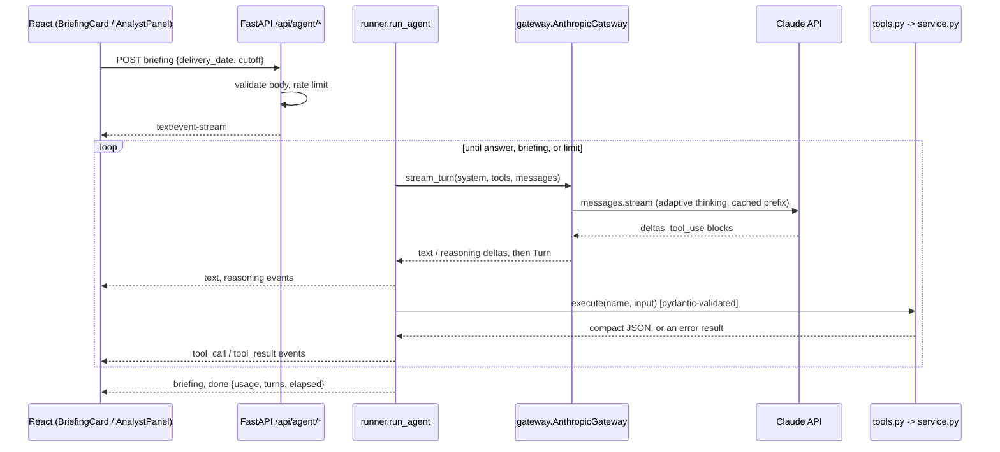

# AI desk analyst: design

WindSight's dashboards answer the questions we anticipated. The analyst answers the ones we did not:
"Is the standard cover enough for tomorrow?", "Should we wait for the 09:30 run?", "What did the worst
days have in common?". It is a Claude agent that plans its own research over WindSight's data, and a
one-click **pre-gate briefing** that ends in a structured, risk-rated recommendation.

## Principles

1. **The model reasons; code computes.** The agent never does arithmetic on raw data and never sees the
   database. It calls tools that run the same `service.py` code as the dashboard, so its numbers match
   the screens, and the tools are unit-tested like the rest of the backend.
2. **Decision time and hindsight are separate tools.** `get_decision_view` contains no actuals.
   Outturn only comes from `get_outturn`, whose payload is tagged `"hindsight": true` and whose
   description tells the model never to present it as known at the cut-off. A test asserts the
   decision view has no actual or error fields.
3. **Out-of-sample by construction.** The dashboard's P10 band is fitted on all of January (in-sample).
   `get_trailing_performance` only uses hours already metered before the decision time, giving a
   walk-forward band the agent uses to challenge the standard cover. On 15 Jan it implies 132.4 GWh
   of cover against the in-sample 99.7 GWh, because forecasts had run 1.8 GW high the week before.
4. **Structured where it matters.** The briefing is not free text. The agent must call
   `publish_briefing`, whose input is validated by pydantic (risk level enum, bounded lists, numeric
   fields). An invalid briefing goes back to the model as an error to repair; a valid one ends the run.
5. **Auditable.** Every tool call, its input, timing and the exact JSON returned are streamed to the
   UI and can be opened beside the answer. Token usage and cache hits are shown per run.
6. **Bounded and fail-safe.** Steps, wall time and request rate are capped; every upstream failure
   becomes a readable, retry-aware message; the dashboard never depends on the agent.

## Architecture

| Module | Responsibility |
|---|---|
| `backend/app/agent/tools.py` | Tool registry: pydantic input models, handlers over `service.py`, JSON schemas, `execute()` that never raises |
| `backend/app/agent/briefing.py` | `Briefing` schema and the terminal `publish_briefing` tool |
| `backend/app/agent/prompts.py` | Static system prompt (cacheable), briefing task, UI-context note |
| `backend/app/agent/runner.py` | The loop: a generator of typed events; turn and deadline limits; tool-result bookkeeping |
| `backend/app/agent/gateway.py` | The only module importing the Anthropic SDK; maps SDK errors to `GatewayError(retryable)` |
| `backend/app/agent/guard.py` | Sliding-window rate limits per client IP plus a per-instance daily cap |
| `backend/app/main.py` | `/api/agent/status`, `/chat`, `/briefing`; request validation; SSE framing |
| `frontend/src/agent/` | SSE parser, pure `runReducer`, `useAgentRun`, conversation provider |
| `frontend/src/components/agent/` | `BriefingCard`, `AnalystPanel`, `AgentTrace`, safe `Markdown` renderer |

## Tools

| Tool | Returns | Notes |
|---|---|---|
| `get_dataset_overview` | Window, run schedule, gate times, headline accuracy | Orientation |
| `get_decision_view` | Run used and age, forecast / P10 / extra GWh, peak and high-wind hours, hourly F/P10/P90 | No actuals |
| `get_trailing_performance` | MAE, bias, walk-forward q10/q90 and the cover they imply | Only hours metered before decision time |
| `get_accuracy_summary` | January KPIs, shortfall quantiles, error by forecast level, worst hours | By cut-off or lead time |
| `get_lead_time_curve` | MAE / bias / P90 error at 0–48 h lead | "Is waiting worth it?" |
| `compare_cutoffs` | Run, forecast and P10 at several cut-offs, flags post-gate cut-offs | |
| `rank_days` | Best or worst days by MAE with energy totals | |
| `get_outturn` | Actual energy, MAE, bias, largest misses, hours below P10 | Hindsight only |
| `publish_briefing` | (briefing runs only) validated structured briefing | Ends the run |

Outputs are rounded and summarised (GW / GWh, no half-hourly dumps): the largest is about 2 KB, which
keeps turns fast and context small.

## Model configuration

- `claude-opus-5-5` (override with `AGENT_MODEL`), streaming, `max_tokens` 16,000.
- Adaptive thinking with `display: "summarized"`, so a short reasoning summary can be shown collapsed
  in the trace. `output_config.effort` defaults to `medium` (`AGENT_EFFORT`).
- `fallbacks: "default"` with beta `server-side-fallback-2026-07-01`: if a safety classifier declines a
  request, the API re-runs it on a fallback model inside the same call. `AGENT_FALLBACKS=off` removes it.
- The tools and system prompt form a static prefix marked `cache_control: ephemeral`; the UI reports
  cached input tokens per run.
- Tool definitions set `eager_input_streaming`; since that skips server-side validation, every input is
  validated with pydantic before execution, and a turn cut off at `max_tokens` never runs its tools.
- Forced tool choice is not available on this model, so the briefing task instructs the model to finish
  with `publish_briefing`. If it answers in prose instead, the card shows the text.

## Guardrails

| Risk | Control |
|---|---|
| Invented numbers | Prompt rule plus tools as the only data source; every figure is traceable in the trace |
| Hindsight leaking into "what we knew" | Separate tool, tagged payload, test on the decision view |
| In-sample band overstating confidence | Walk-forward tool; the briefing prompt requires using it |
| Other websites spending the key from a visitor's browser | CORS allows only `GET` cross-origin, so browser `POST`s to the agent endpoints only work same-origin |
| Client-forged context | Chat history is text-only; tool calls/results from the client are rejected (422) |
| Prompt bloat / abuse | ≤ 20 messages, ≤ 4,000 chars each, `extra="forbid"` on every body |
| Runaway loops / cost | ≤ 8 model turns, `AGENT_DEADLINE_S` (100 s), rate limits 6/min and 40/h per IP, 500/day per instance, Anthropic workspace spend limit |
| XSS through model output | Markdown rendered to React elements, no `dangerouslySetInnerHTML` |
| Upstream outage | Typed error mapping (auth, permission, rate limit, bad request, 5xx, network) with a `retryable` flag; the dashboard is unaffected |
| Dropped stream (proxy or platform timeout) | Client turns a stream that ends without `done` into a retryable error |

## Testing

No test calls the real API.

- `tests/test_agent.py` (43 tests): each tool against the snapshot, including figures that match
  the dashboard, no actuals in the decision view, the walk-forward window boundary and rejected
  inputs. It also covers loop semantics with a scripted gateway: parallel tool results go back in one
  message; invalid input is returned as `is_error`; truncated and refused turns run no tools; turn and
  time limits; a valid briefing ends the run; an invalid one is sent back for repair. Finally it covers
  the HTTP layer (SSE framing, context injection, 422/429/503) and the rate limiter with a fake clock.
- `tests/test_agent_sdk.py`: the real `AnthropicGateway` and SDK against a mocked HTTP transport
  replaying Anthropic-format event streams. It proves stream parsing, assembly of tool input split
  across deltas, the request shape (beta header, fallbacks, thinking) and that thinking and tool_use
  blocks are echoed back unchanged on the next turn. It also covers error mapping for 401/400/529.
- Frontend: SSE parser fuzzed across every chunk boundary (it caught a CRLF split bug), run reducer,
  history builder, markdown blocks, and an integration test that streams a briefing into the Decision
  Desk and asserts the rendered recommendation.

## Next steps

- Eval set: 20–30 desk questions with checkable answers (numbers from the tools), scored on every
  prompt or model change.
- Persist briefings per delivery day and compare the agent's recommended cover with outturn, so the
  agent's own track record becomes a metric.
- Proactive mode: re-run the briefing when a new forecast run lands before the gate and alert when the
  recommendation moves by more than the P10 cover.
- Shared rate limiting (e.g. Redis or Vercel KV) for multi-instance accuracy.
